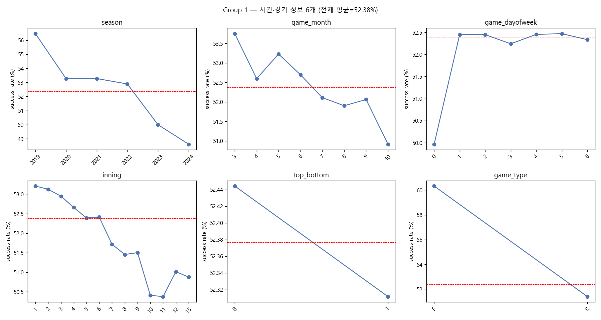
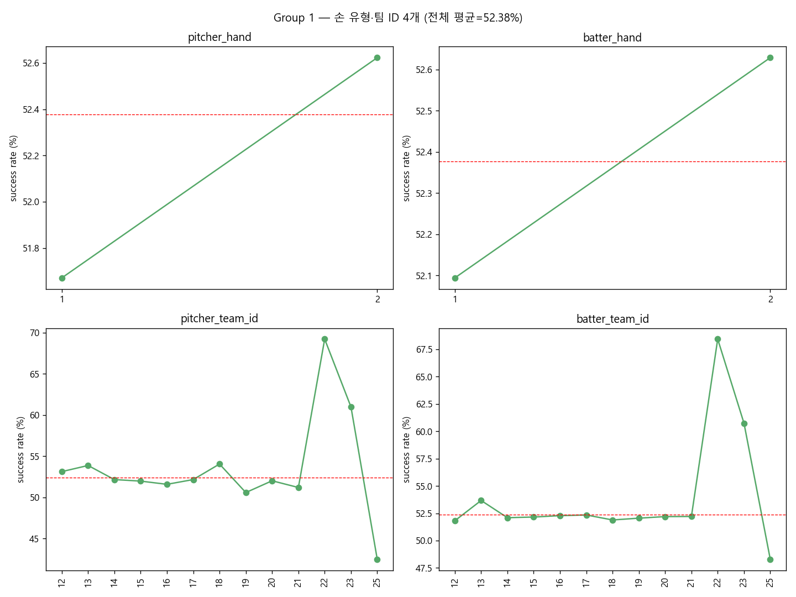
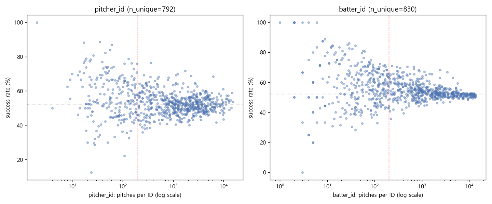

# Group 1 EDA — 시간·경기 정보 / 손 유형·팀 ID / 선수 ID

원 담당자(허원준)가 정리한 노트를 바탕으로, 모든 수치를 실제 코드
재실행으로 재검증하고 리포트 구조를 재구성한 버전이다. 실행 코드는
[`run_eda.py`](run_eda.py) (재실행: `python reports/eda_group1/run_eda.py`,
실행 로그 원본은 [`eda_run_log.txt`](eda_run_log.txt)). 이 문서의 모든
수치는 그 로그와 `tables/*.csv`에서 그대로 가져왔다 — 추정치는 없음.

데이터: `data/train.csv` (2019~2024, 1,475,092행). `test.csv`는 사용하지
않았고, 여기 나온 어떤 값도 test.csv 피처 생성에 직접 대입하지 않는다
(CLAUDE.md 누수 규칙 6번 참고).

**원본 노트와의 차이점** (§0 참고): 원본의 대부분 수치는 재검증 결과
전부 일치했다 — 좋은 EDA였다. 다만 구조상 다음 세 가지를 바꿨다.
1. 원본 2.2절(이닝×LI×점수차×주자상태), 3.2절(손유형×구종군비율)은
   그룹 3(주자·LI)/그룹 4(투수 구종비율) 컬럼을 함께 쓰는 교차 분석이라
   이 리포트에서는 빼고, **최종 통합 EDA**(`reports/eda_final/`)에서
   다룬다 — 그룹별 리포트가 서로 다른 그룹 컬럼을 중복 분석하지 않게
   하기 위함.
2. 원본 4.3절("선수 ID × 과거 표본 수 × 누적 성공률")도 뺐다 — 이
   분석과 개념적으로 동일한 "표본 크기가 작을수록 비율을 그대로 믿기
   어렵다"는 결론을 그룹 4가 공식 `asof_pitcher_*` 컬럼으로 이미 훨씬
   자세히 다뤘다(`reports/eda_group4/README.md` §Insight D 예정). 중복
   대신 §7에서 이 관계를 짧게만 인용한다.
3. 그 대신 §7에 **누수 주의 경고**를 명시적으로 추가했다 — 원본이
   "선수 ID × 과거 표본 수 × 누적 성공률" 분석에 쓴 "누적 성공률"이
   train.csv 전체를 ID로 groupby한 값인지, 공식 `asof_*`(투구 시점까지만
   누적) 값인지 문서상 구분이 안 되어 있었다. train.csv 전체를 EDA로
   들여다보는 것 자체는 문제없지만, 이 전체-집계 값을 그대로 test.csv
   피처로 옮기면 미래 정보가 새는 target encoding이 된다 — 실제 피처로
   쓸 때는 반드시 공식 `asof_*` 컬럼을 써야 한다는 점을 명시했다.

---

## 0. 담당 컬럼 12개

| 구분 | 컬럼 |
|---|---|
| 시간·경기 정보 (6) | `season`, `game_month`, `game_dayofweek`, `inning`, `top_bottom`, `game_type` |
| 손 유형·팀 ID (4) | `pitcher_hand`, `batter_hand`, `pitcher_team_id`, `batter_team_id` |
| 선수 ID (2) | `pitcher_id`, `batter_id` |

---

## 1. 데이터 품질

- Shape: `(1,475,092, 14)` (12개 담당 컬럼 + `control_success` + 검증용
  `asof_pitcher_n`).
- **결측치 0건**, **완전 중복행 0건** ([`00_quality_summary.csv`](tables/00_quality_summary.csv)).
- `season`(2019-2024, 6개), `game_month`(3~10월, 8개), `game_dayofweek`(0~6, 7개),
  `inning`(1~13, 13개), `top_bottom`/`game_type`(각 2개 범주), `pitcher_hand`/
  `batter_hand`(각 1/2 코드), `pitcher_team_id`/`batter_team_id`(각 13개 팀),
  `pitcher_id`(792명), `batter_id`(830명) — 전부 정상 범위, 이상값 없음.

---

## 2. 단변량 분석

### 2a. 시간·경기 정보 6개 (그리드)

| 컬럼 | 레벨 수 | 값 간 최대 차이 | 비고 |
|---|---|---|---|
| `season` | 6 | **7.8565%p** | 2019 56.4670% → 2024 48.6105%, 거의 단조 하락 |
| `game_month` | 8 | 2.8335%p | 3월 53.7506%(최고) · 10월 50.9171%(최저) |
| `game_dayofweek` | 7 | 2.5047%p | 월요일(0) 49.9661%만 낮고, 화~일은 52.24~52.47%로 좁게 모임(화~일 폭 0.2298%p) |
| `inning` | 13 | 2.8311%p | 1회 53.2079% → 11회 50.3768%, 후반으로 갈수록 대체로 하락 |
| `top_bottom` | 2 | 0.1327%p | B 52.4443% · T 52.3116% — 사실상 차이 없음 |
| `game_type` | 2 | **8.9246%p** | F 60.3271% · R 51.4025% |

`game_dayofweek`의 월요일 이상치는 표본이 매우 작다(n=14,754 vs 화~일
232,390~252,121) — 실제로는 §9에서 보듯 "월요일 표본 대부분이 R 경기
유형"인 구성 효과일 가능성이 크다.

### 2b. 손 유형·팀 ID 4개 (그리드)

| 컬럼 | 레벨 수 | 관측 범위 | 비고 |
|---|---|---|---|
| `pitcher_hand` | 2 | 51.6705%(코드1) ~ 52.6228%(코드2) | 단독 차이 0.9523%p |
| `batter_hand` | 2 | 52.0939%(코드1) ~ 52.6289%(코드2) | 단독 차이 0.5350%p |
| `pitcher_team_id` | 13 | 42.4658% ~ 69.2308% | 범위 26.7650%p, 단 양끝 팀(22번 n=676, 25번 n=292)은 표본이 작음 |
| `batter_team_id` | 13 | 48.2877% ~ 68.4347% | 범위 20.1470%p, 마찬가지로 양끝은 소표본 |

손 유형 단독 차이는 1%p 미만으로 작다 — 손 유형은 상대 손과의 조합으로
봐야 신호가 커진다(§6).

### 2c. 선수 ID 표본 크기 vs 성공률

([`02_id_sample_summary.csv`](tables/02_id_sample_summary.csv))

| 구분 | 고유 ID 수 | ID당 행 수 중앙값 | 100행 미만 | 200구 이상 | 200구 이상 하위10%/중앙값/상위10% |
|---|---|---|---|---|---|
| `pitcher_id` | 792 | 856.5 | 143명 | 577명 | 45.66% / 52.11% / 59.29% |
| `batter_id` | 830 | 473.0 | 229명 | 507명 | 48.95% / 52.68% / 60.69% |

산점도에서 표본이 적은 ID일수록(왼쪽) 성공률이 0~100% 넓게 흩어지고,
표본이 많아질수록(오른쪽) 전체 평균(52.38%) 근처로 수렴한다 — 전형적인
소표본 변동. **ID 자체를 그대로 범주형으로 넣기보다 표본 크기와 함께
해석해야 한다**는 점은 §7에서 다시 다룬다.

---

## 3. season × game_type 상호작용

([`03_season_gametype_rate.csv`](tables/03_season_gametype_rate.csv),
그림 `figures/04_season_gametype_trend.png`)

| season | F 성공률 | R 성공률 | F − R |
|---|---|---|---|
| 2019 | 68.93% | 54.95% | **+13.98%p** |
| 2020 | 58.78% | 52.69% | +6.08%p |
| 2021 | 70.38% | 51.28% | +19.11%p |
| 2022 | 70.87% | 50.37% | +20.51%p |
| 2023 | 47.29% | 50.31% | **−3.02%p** |
| 2024 | 45.93% | 48.97% | −3.04%p |

**2023년을 기점으로 F/R 우위가 완전히 뒤집힌다** — 2019~2022년엔 F가
6~20%p 더 높다가, 2023~2024년엔 오히려 R이 3%p 더 높다. `game_type`을
고정 효과로 쓰면 안 되고, `season × game_type` 상호작용으로만 검증해야
한다는 원본 결론에 동의한다 (공식 데이터 딕셔너리에 F/R 풀네임이 없어
정확한 의미는 미확인 — 추정하지 않음).

---

## 4. season × game_month heatmap

([`04_season_month_rate.csv`](tables/04_season_month_rate.csv), 그림
`figures/05_heatmap_season_month.png`)

2020~2023년은 3월 데이터가 없다(NaN — 시즌 개막이 4월 이후였거나 수집
범위 차이로 추정, 원인은 데이터만으로 확정 불가). 월별 순위가 시즌마다
바뀐다 — 예: 10월은 2019년엔 시즌 내 최고(59.80%)였지만 2021년엔
최저(49.12%)에 가깝다. **`game_month` 단독을 계절 효과로 취급하면
안 되고, season과의 상호작용에서만 추가 성능이 있는지 확인해야 한다.**

---

## 5. 이닝과 경기 진행

([`05_inning_bin_summary.csv`](tables/05_inning_bin_summary.csv))

| 이닝 구간 | n | 성공률 |
|---|---|---|
| 1-3회 | 498,766 | 53.0956% |
| 4-6회 | 494,934 | 52.4868% |
| 7-9회 | 461,440 | 51.5629% |
| 연장 | 19,952 | 50.4862% |

### 동일 투수 비교 (§5b)

1-3회와 7-9회 모두 200구 이상 던진 동일 투수 **178명**만 놓고 비교:
- **68.54%**(122/178명)에서 7-9회 성공률이 1-3회보다 낮음
- 평균 차이 **-2.6804%p** (late − early)

투수 구성이 바뀌는 효과를 걸러내도 후반 이닝 성공률 저하가 남는다 —
`inning`은 단순 범주가 아니라 순서 정보를 가진 피처로 유지할 근거가
있다. 다만 원인(피로, 상대 타순, 등판 상황 변화 등)은 이 분석만으로
단정할 수 없다 — "연관"으로만 서술한다.

---

## 6. pitcher_hand × batter_hand 매치업

([`06_hand_matchup.csv`](tables/06_hand_matchup.csv), 그림
`figures/06_heatmap_hand_matchup.png`)

| pitcher_hand | batter_hand | n | 성공률 |
|---|---|---|---|
| 1 | 1 | 170,292 | 49.0927% |
| 1 | 2 | 211,059 | 53.7504% |
| 2 | 1 | 525,455 | 53.0666% |
| 2 | 2 | 568,286 | 52.2124% |

- 같은 손 유형 조합(1-1, 2-2) 가중평균: **51.4931%**
- 다른 손 유형 조합(1-2, 2-1) 가중평균: **53.2625%**
- 네 조합 최대-최소 차이: **4.6576%p**

각 손 유형의 단독 차이(§2b, 1%p 미만)보다 맞대결 조합에서 신호가
4배 이상 커진다 — 야구의 platoon 효과와 일치하는 패턴. `pitcher_hand`,
`batter_hand`를 따로 넣기보다 조합(또는 상호작용 피처)을 우선
검증해야 한다.

---

## 7. 팀 ID 분석

### 7a. pitcher_team_id × batter_team_id

([`07_team_matchup.csv`](tables/07_team_matchup.csv), 그림
`figures/07_heatmap_team_matchup.png`)

- 가능한 조합 13×13=169개 중 **96개만 관측** (나머지는 시즌별로 두
  팀이 맞붙지 않았거나 표본에 없음)
- 투수팀==타자팀인 조합은 **0건** (같은 팀끼리는 경기하지 않으므로
  당연한 결과 — 데이터 무결성 확인용으로도 유효)
- 팀 22, 25번은 전체 표본이 각각 676구, 292구로 작아 이 두 팀이 만드는
  극단값(§2b의 42~69% 범위)은 표본 변동을 함께 고려해야 함

### 7b. 선수 이동

- 투수 792명 중 **164명(20.71%)**이 여러 팀에서 관측됨
- 같은 시즌 안에서 여러 팀으로 관측된 투수-시즌 조합: **46건**

**팀 ID는 선수에게 고정된 속성이 아니다.** 선수 능력과 팀 환경(구장,
포수진, 코칭스태프 등)을 분리하려면 `pitcher_id × season ×
pitcher_team_id`를 함께 보고, 이전 팀 정보를 현재 팀 정보로 오인하지
않아야 한다.

---

## 8. 시즌별 신규 선수 비율

([`08_player_season_novelty.csv`](tables/08_player_season_novelty.csv),
그림 `figures/08_new_player_share.png`)

| season | 신규 투수 투구 비율 | 신규 타자 상대 투구 비율 |
|---|---|---|
| 2020 | 22.38% | 11.60% |
| 2021 | 20.57% | 8.78% |
| 2022 | 15.74% | 11.02% |
| 2023 | 13.80% | 9.40% |
| 2024 | 19.86% | 9.30% |

(2019년은 데이터 시작 연도라 100%로 정의상 당연 — 표에서 제외)

매 시즌 전체 투구의 14~22%가 이전 시즌에 없던 투수를 상대한다. **ID
기반 신호(§2c)만으로는 새 선수를 처리할 수 없고, 표본 수·최근 기록과
함께 사용해야 한다.** 시즌 초(3월)라는 이유만으로 모든 투수를
과거 기록 부족으로 취급해서도 안 된다 — 신규 여부는 `game_month`가
아니라 개별 선수의 `asof_pitcher_n`(공식 컬럼)으로 판단해야 정확하다.

> **누수 주의**: 위 "신규 선수 비율"은 EDA 목적의 train.csv 전체
> 집계이며, 그 자체를 test.csv 피처로 옮기면 안 된다(어떤 시즌이
> "신규가 많은 시즌"인지는 그 시즌 데이터를 전부 봐야 계산되므로
> row-local하지 않음). 실제 모델 피처로 cold-start를 표현할 때는 반드시
> 공식 `asof_pitcher_n`/`asof_batter_n`(투구 시점까지만 누적, 이미
> `src/features.py`에서 `pitcher_experience_log`/`batter_experience_log`로
> 사용 중)을 써야 한다.

---

## 9. game_dayofweek × game_type (우선순위 낮은 조합 검증)

([`09_weekday_gametype_rate.csv`](tables/09_weekday_gametype_rate.csv))

| 요일 | F 성공률 | F 표본 | R 성공률 | R 표본 |
|---|---|---|---|---|
| 월(0) | 63.95% | 294 | 49.68% | 14,460 |
| 화(1) | 60.44% | 26,239 | 51.44% | 206,151 |
| 수(2) | 60.49% | 27,218 | 51.43% | 214,538 |
| 목(3) | 60.08% | 23,950 | 51.36% | 212,372 |
| 금(4) | 59.70% | 31,018 | 51.42% | 216,944 |
| 토(5) | 60.92% | 30,686 | 51.30% | 221,435 |
| 일(6) | 60.26% | 21,599 | 51.58% | 228,188 |

월요일 F 표본은 294구뿐이라 다른 조합과 같은 무게로 볼 수 없다. 월요일을
빼고 화~일만 보면 F는 59.70~60.92%, R은 51.30~51.58%로 요일 간 차이가
작다. **§2a에서 본 "월요일 전체 성공률이 낮다"는 현상은 요일 자체의
효과가 아니라, 월요일에 F 경기가 거의 없고 R(성공률이 낮은 유형) 비중이
훨씬 높은 구성 효과다.** 요일은 단독 피처 우선순위를 낮춘다.

---

## 10. 주요 발견 (요약, 우선순위 순)

| 우선순위 | 관계 | 판단 근거 |
|---|---|---|
| 높음 | `season` | 2019→2024 7.8565%p 하락, 그룹 1에서 가장 큰 단일 신호 |
| 높음 | `inning` (순서 정보) | 동일 투수 비교(§5)에서도 후반 이닝 저하가 남음(-2.68%p, 68.54%가 하락) |
| 높음 | `pitcher_hand × batter_hand` | 단독 차이 <1%p → 맞대결 조합 4.6576%p (§6) |
| 조건부 | `game_type` | F/R 차이가 큼(8.92%p)이나 2023년 기점으로 방향이 뒤집힘(§3) — `season × game_type`로만 사용 |
| 조건부 | `pitcher_team_id × batter_team_id` | 팀 간 차이는 있으나 20.71%가 팀을 옮기고(§7b) 소표본 극단값 포함 — 고정 매치업 능력으로 사용 금지 |
| 조건부 | 선수 ID (`pitcher_id`/`batter_id`) | 표본 클수록 안정화되지만 단독 사용 위험(§2c) — 표본수·최근기록과 결합 필수 |
| 낮음 | `game_dayofweek`, `top_bottom` | 단독 차이 각각 2.50%p(대부분 화~일 0.23%p), 0.13%p — §9에서 요일 효과는 사실 game_type 구성 효과로 확인됨 |

---

## 11. Feature Engineering 후보

| 후보 | 근거 | 기존 피처와의 관계 | 검증 필요성 |
|---|---|---|---|
| `season`을 그대로 유지 + 시즌별 확률 보정 | §2a, §10 — 최대 단일 신호 | 신규 아님, 현재도 raw로 사용 중 | season을 calibration 기준으로 쓸 때 개선되는지 validation 필요 |
| `pitcher_hand == batter_hand` (`same_hand_matchup`) | §6 — 손 유형 조합 신호가 단독보다 4배 큼 | **이미 `src/features.py`에 `same_hand_matchup`으로 존재**(exp_002) | 신규 아님 — 그대로 유지, importance 재확인 |
| `inning`을 순서형으로 유지 | §5 — 동일 투수 비교에서도 후반 이닝 저하 확인 | 신규 아님(raw 컬럼), `late_inning`(inning>=7)도 이미 존재 | 유지 |
| `pitcher_team_id × season` 상호작용 (신규 제안) | §7b — 팀 ID가 선수 고정 속성이 아님 | 없음 | 팀 환경 효과와 선수 능력을 분리하는 데 도움되는지 ablation |
| `is_new_pitcher`/`is_new_batter` (asof_n==0 여부) | §8 — 매 시즌 14~22%가 신규 | `pitcher_experience_log`/`batter_experience_log`(log1p(n))로 유사 정보 이미 존재 | log1p보다 이진 cold-start 플래그가 추가 정보를 주는지 비교 |

---

## 12. 삭제 후보

없음 — 그룹 1의 12개 컬럼은 서로 정보가 중복되지 않는다(그룹 2의
`run_total_before` 같은 수학적 100% 중복 사례와 다름). 팀 ID·요일처럼
단독 신호가 약한 컬럼도 상호작용에서 쓰일 수 있어 지금 삭제를
제안하지 않는다.

---

## 13. 추가 교차 분석 후보 (담당 범위 밖 — 최종 통합 EDA에서 다룸)

| 후보 | 왜 필요해 보이는지 |
|---|---|
| `inning × li × score_diff_pitcher_team × 주자 상태` | 원본 노트 2.2절 — 이닝이 후반일수록 낮다는 신호는 LI 구간을 통제해도 남음(원본에서 확인), 3그룹 컬럼과 결합 필요 |
| `pitcher_hand × batter_hand × 과거 구종군 비율` | 원본 노트 3.2절 — 손 유형 조합 안에서도 구종 성향(그룹4 `asof_pitcher_fastball/breaking/offspeed_rate`)에 따라 46.88~56.80%까지 벌어짐 |
| `season × asof_pitcher_success_rate` | §2a 시즌 하락이 개별 투수의 실제 능력 저하인지, 판정 기준 변화인지 구분 필요 |
| `pitcher_team_id × asof_pitcher_*` | 팀(구장/포수진) 효과와 선수 능력 효과 분리 |

---

## 14. 팀 회의용 핵심 결론

1. **관찰**: 전체 제구 성공률이 2019년 56.47%에서 2024년 48.61%로
   꾸준히 하락한다(그룹 2 리포트 §7과 동일 현상, 여기서는 season을
   그룹 1 컬럼으로 재확인).
   **근거**: §2a 표.
   **해석**: 그룹 1에서 관측된 단일 효과 중 가장 크다(다음으로 큰
   `game_type` 8.92%p보다도 큼, 단 game_type은 방향이 뒤집히므로
   실질적으로는 season이 가장 신뢰할 수 있는 신호).
   **다음 action**: season 기반 확률 보정을 validation에서 비교.

2. **관찰**: `game_type`(F/R)의 성공률 차이는 2023년을 기점으로
   방향이 완전히 뒤집힌다.
   **근거**: §3 표(2019~2022 F가 6~20%p 높음 → 2023~2024 R이 3%p 높음).
   **해석**: 공식 문서에 F/R 정의가 없어 원인은 추정하지 않는다(리그
   구조 변경 가능성 등은 미확인 가설).
   **다음 action**: `game_type`을 고정 효과로 쓰지 말고 `season ×
   game_type` 상호작용으로만 검증.

3. **관찰**: 손 유형은 단독보다 투수-타자 맞대결 조합으로 봐야 신호가
   커진다.
   **근거**: §6 — 단독 차이 <1%p, 조합 차이 4.66%p.
   **해석**: platoon 효과와 일치. 이미 `src/features.py`에
   `same_hand_matchup`으로 반영돼 있음.
   **다음 action**: 신규 작업 없음, feature importance만 재확인.

4. **관찰**: 후반 이닝일수록 제구 성공률이 낮고, 이는 투수 구성이
   바뀌는 효과를 제거한 동일 투수 비교에서도 남는다.
   **근거**: §5 — 178명 동일 투수 비교, 68.54%에서 후반이 더 낮음
   (평균 -2.68%p).
   **해석**: 피로·상대 타순·등판 상황 변화 등이 섞여 있어 "피로
   효과"로 단정하지 않는다 — "연관"으로만 서술.
   **다음 action**: `inning`을 순서형으로 유지(이미 그렇게 사용 중).

5. **관찰**: 팀 ID는 선수에게 고정된 속성이 아니다.
   **근거**: §7b — 투수 20.71%가 여러 팀에서 관측, 46개 투수-시즌
   조합은 한 시즌 안에서도 팀이 바뀜.
   **해석**: `pitcher_team_id`를 선수 능력의 대리 변수로 쓰면 위험 —
   팀 이동 시점을 놓치면 이전 팀 정보가 현재 팀 정보로 오인될 수 있음.
   **다음 action**: 팀 ID 관련 피처는 `season`과 함께 넣어 시간 순서
   검증에서 추가 성능이 있는지만 확인.

6. **관찰**: 요일 효과처럼 보였던 "월요일 성공률이 낮다"는 현상은
   요일 자체가 아니라 game_type 구성 차이였다.
   **근거**: §9 — 월요일은 F 경기 표본이 294구뿐이고 나머지가 거의
   R(성공률이 낮은 유형)이라, 화~일만 비교하면 요일 간 차이가
   0.23%p로 줄어듦.
   **해석**: 원본 노트가 이미 "요일 단독 우선순위 낮음"으로 정확히
   판단했고, 이번 재검증에서 그 원인(구성 효과)까지 추가로 확인했다.
   **다음 action**: `game_dayofweek`는 단독 피처로 넣지 않음.

---

## 15. 중요 원칙 (본 EDA 전체에 적용)

- raw data(`data/train.csv`) 수정 없음, test data 기반 fitting/분포
  사용 없음, 미래 정보 사용 없음.
- EDA 결과만으로 컬럼을 채택·제거하지 않음 — 모든 후보는 validation
  ablation이 필요하다고 명시.
- 상관관계가 낮다는 이유만으로 제거 결정을 내리지 않음.
- 이 문서의 모든 수치는 `eda_run_log.txt`와 `tables/*.csv`에서 실제
  실행된 값만 사용 — 추정치 없음.
- 작은 차이(<1%p 수준)는 과도하게 해석하지 않음, 표현은 "연관"·
  "패턴"·"가설"로 한정 — 인과관계로 서술하지 않음.
- train.csv 전체를 groupby한 EDA 전용 집계(예: §8 신규 선수 비율,
  §2c ID별 성공률)를 그대로 test.csv 피처로 옮기지 않음 — 실제 피처는
  공식 `asof_*` 컬럼(투구 시점까지만 누적) 기반으로만 만든다.
