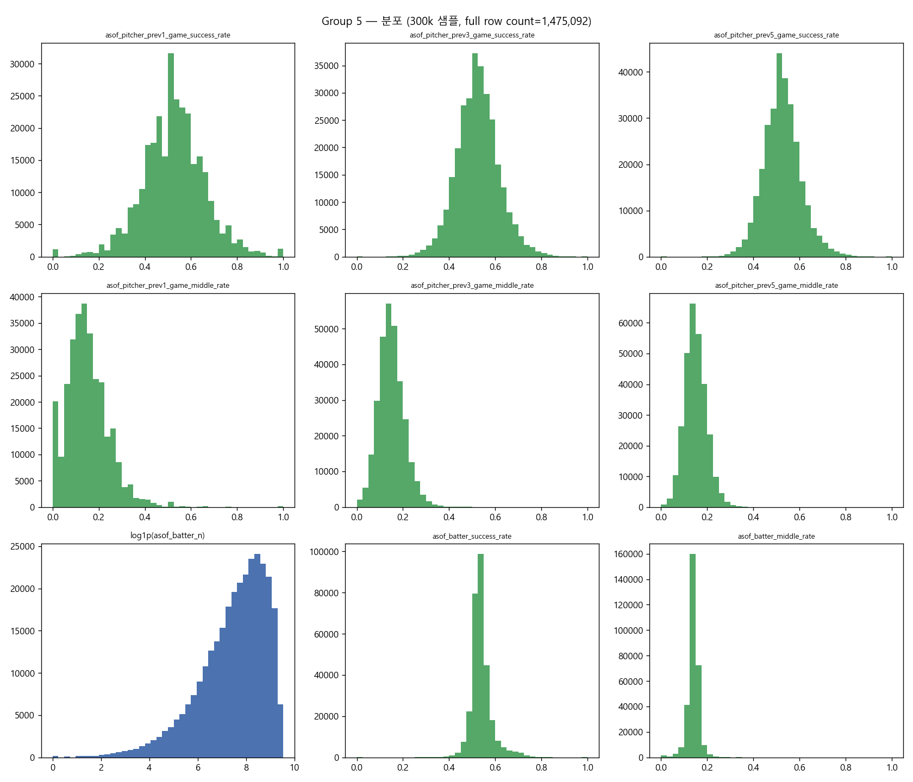

# Group 5 EDA — 투수 최근 폼 추세 + 타자 상대 과거 기록

담당자 문서가 아직 도착하지 않아 직접 수행했다(그룹 2와 동일한
방식 — 문서 없이 실제 코드 실행만으로 작성). **담당자 문서가 오면
이 리포트와 대조해 보강할 예정이다.** 실행 코드는
[`run_eda.py`](run_eda.py) (재실행: `python reports/eda_group5/run_eda.py`,
로그 원본은 [`eda_run_log.txt`](eda_run_log.txt)). 모든 수치는 그
로그와 `tables/*.csv`에서 그대로 가져왔다.

데이터: `data/train.csv` (2019~2024, 1,475,092행). `test.csv`는 사용하지
않았다.

---

## 0. 담당 컬럼 9개

| 구분 | 컬럼 | 설명 |
|---|---|---|
| 투수 최근 폼 | `asof_pitcher_prev1_game_success_rate` | 직전 1경기 제구 성공률 |
| 투수 최근 폼 | `asof_pitcher_prev3_game_success_rate` | 직전 3경기 제구 성공률 |
| 투수 최근 폼 | `asof_pitcher_prev5_game_success_rate` | 직전 5경기 제구 성공률 |
| 투수 최근 폼 | `asof_pitcher_prev1_game_middle_rate` | 직전 1경기 가운데/위험코스 비율 |
| 투수 최근 폼 | `asof_pitcher_prev3_game_middle_rate` | 직전 3경기 가운데/위험코스 비율 |
| 투수 최근 폼 | `asof_pitcher_prev5_game_middle_rate` | 직전 5경기 가운데/위험코스 비율 |
| 타자 상대 기록 | `asof_batter_n` | 타자가 상대한 누적 투구 수 |
| 타자 상대 기록 | `asof_batter_success_rate` | 타자 상대 제구 성공률 |
| 타자 상대 기록 | `asof_batter_middle_rate` | 타자 상대 가운데/위험코스 비율 |

이 그룹은 그룹 4(투수 장기 누적 지표)의 두 자매 계열이다:
prev1/3/5는 그룹 4의 `asof_pitcher_success_rate`/`middle_rate`를
"최근 N경기"로 좁힌 버전이고, `asof_batter_*`는 그룹 4의 투수 지표를
타자 관점으로 미러링한 버전이다. `exp_002`의 `pitcher_recent_form_delta`,
`pitcher_form_trend_isolated`, `pitcher_middle_trend_isolated`,
`pitcher_form_volatility`, `pitcher_minus_batter_success`,
`batter_middle_minus_success`가 전부 이 그룹 컬럼을 직접 사용한다 —
이 리포트는 그 피처들의 원재료를 검증하는 역할도 겸한다.

---

## 1. 데이터 품질

Shape `(1,475,092, 15)`, 고유 `pitcher_id` 792명, `batter_id` 830명
([`00_quality_summary.csv`](tables/00_quality_summary.csv)).

| 컬럼 | 결측 | 결측률 |
|---|---|---|
| `asof_pitcher_prev1/3/5_game_success_rate` (3개) | 각 29,185건 | 각 1.9785% |
| `asof_pitcher_prev1/3/5_game_middle_rate` (3개) | 각 29,185건 | 각 1.9785% |
| `asof_batter_n` | 0건 | 0% |
| `asof_batter_success_rate` | 830건 | 0.0563% |
| `asof_batter_middle_rate` | 830건 | 0.0563% |

---

## 2. `asof_batter_*` 결측 = cold-start (그룹4 §2와 동일 패턴)

- `asof_batter_n == 0`인 행 **정확히 830건**
- `asof_batter_success_rate`/`middle_rate` 모두 이 830건에서만 결측
  (`n>0`인데 결측 0건)
- 830건의 고유 `batter_id` 수 = **830명** = 전체 타자 수와 정확히 일치

그룹 4가 투수 쪽에서 확인한 cold-start 구조가 타자 쪽에서도 똑같이
성립한다 — 타자 830명 전원이 정확히 한 번씩 이 상태를 거친다.

---

## 3. prev1/3/5 결측 계층 구조 — 예상과 다른 점 발견

([`03_prev_missing_hierarchy.csv`](tables/03_prev_missing_hierarchy.csv))

**당초 예상은 "직전 1경기 요구 < 직전 3경기 요구 < 직전 5경기 요구"라
결측률이 `prev1 ≤ prev3 ≤ prev5` 순으로 계단식으로 늘어날 것이었다.
실제로는 세 컬럼의 결측이 정확히 같은 29,185건으로, 서로 완전히
같은 행에서만 결측이다** (`prev1` 결측인데 `prev3`는 있는 행 0건,
`prev3` 결측인데 `prev5`는 있는 행 0건). `asof_pitcher_n==0`인 792건은
이 29,185건에 전부 포함된다.

**해석**: 세 윈도우 컬럼이 "경기 수가 부족하면 계산 불가"라는 개별
임계값이 아니라, 하나의 공통 조건(아마도 "직전 경기 기록이 하나도
없는 시즌 첫 등판 시점" 또는 유사한 이진 조건)으로 함께 게이팅되어
있는 것으로 보인다 — 정확한 산출 로직은 공식 문서에 없어 확정하지
않는다("가설"로만 기록). 실무적으로는 **6개 컬럼을 하나의 결측
그룹으로 취급해도 된다**는 뜻이라 처리가 오히려 단순해진다.

---

## 4. 단변량 분포 (3×3 그리드)



([`04_univariate_stats.csv`](tables/04_univariate_stats.csv))

| 컬럼 | mean | std | 25% | 50% | 75% |
|---|---|---|---|---|---|
| `prev1_success_rate` | 52.34% | 13.59%p | 44.33% | 52.38% | 60.53% |
| `prev3_success_rate` | 52.38% | 9.17%p | 46.58% | 52.17% | 57.99% |
| `prev5_success_rate` | 52.44% | 8.08%p | 47.30% | 52.17% | 57.21% |
| `prev1_middle_rate` | 15.06% | 9.24%p | 9.09% | 14.14% | 20.00% |
| `prev3_middle_rate` | 14.94% | 5.62%p | 11.11% | 14.58% | 18.28% |
| `prev5_middle_rate` | 14.89% | 4.76%p | 11.71% | 14.61% | 17.86% |
| `asof_batter_n` | 3,270.8 | 3,049.0 | 788 | 2,263 | 5,007 |
| `asof_batter_success_rate` | 53.97% | 5.16%p | 51.55% | 53.22% | 55.51% |
| `asof_batter_middle_rate` | 14.05% | 2.72%p | 13.03% | 14.20% | 15.17% |

**표본 크기(=평균 낸 경기 수)가 커질수록 표준편차가 줄어드는 패턴이
뚜렷하다**: `success_rate` 표준편차가 prev1(13.59%p) → prev3(9.17%p)
→ prev5(8.08%p)로 줄고, 그룹4의 장기 누적 `asof_pitcher_success_rate`
표준편차(6.18%p, 그룹4 리포트 §4)가 가장 작다 — "평균 내는 경기 수 ↑ →
분산 ↓"라는 통계적으로 당연한 관계가 그대로 확인된다.

`asof_batter_n`(중앙값 2,263)은 그룹4의 `asof_pitcher_n`(중앙값
1,776)보다 크다 — 타자 한 명이 상대하는 누적 투구 수가 투수 한 명의
누적 투구 수보다 많다(타자가 792명 투수 대비 830명으로 조금 더
많지만, 그보다는 타자가 매 타석 여러 투수를 상대해서 누적이 더
빨리 쌓이는 구조로 보인다).

---

## 5. prev1/prev3/prev5 상관관계 — 중첩 윈도우 구조

([`05_corr_prev_success.csv`](tables/05_corr_prev_success.csv),
[`05_corr_prev_middle.csv`](tables/05_corr_prev_middle.csv))

| | prev1 | prev3 | prev5 |
|---|---|---|---|
| **success_rate** — prev1 | 1.00 | 0.6618 | 0.5735 |
| prev3 | 0.6618 | 1.00 | **0.8822** |
| prev5 | 0.5735 | 0.8822 | 1.00 |

prev3-prev5 상관(0.88)이 prev1-prev3(0.66), prev1-prev5(0.57)보다
훨씬 높다 — prev3와 prev5는 창(window)이 3경기 겹치므로 당연히 더
비슷하고, prev1(가장 최근 1경기)은 노이즈가 커서 상대적으로 독립적인
정보를 담고 있다. `middle_rate` 계열도 같은 패턴(prev3-prev5 0.85,
prev1-prev3 0.60, prev1-prev5 0.50).

**장기 누적(`asof_pitcher_success_rate`, 그룹4)과의 상관**은
prev1(0.4016) < prev3(0.6075) < **prev5(0.6931)** 순으로, 윈도우가
길수록 장기 평균에 더 가깝다 — 통계적으로 자연스러운 결과이자, "최근
폼"과 "장기 실력"이 서로 다른 축의 정보임을 뒷받침한다(완전히 같은
정보였다면 셋 다 상관이 1에 가까워야 함).

---

## 6. `exp_002 pitcher_form_trend_isolated` 공식 검증

`src/features.py`의 `_isolated_trend`는 다음 대수를 쓴다:

```python
early_only = (5 * prev5 - 3 * prev3) / 2   # "4~5경기째만의" 평균 추정
trend = prev1 - early_only                  # 최근 1경기 대 그 이전 평균
```

이 공식은 prev3/prev5가 "게임당 동일 가중치의 평균"이라는 가정
아래, `5*prev5`(5경기 합)에서 `3*prev3`(3경기 합)를 빼면 "4~5번째
경기 2개의 합"이 남는다는 대수적 추론이다 — 이번 EDA에서 처음으로
실측 검증했다.

- 계산 가능 행(세 컬럼 모두 non-null): 1,445,907 / 1,475,092
- `early_only`가 합리적 비율 범위(-0.5~1.5, 약간의 마진 포함)를
  벗어나는 행: **0건** — 대수적 외삽이 실제 데이터에서 터무니없는
  값을 만들지 않는다는 뜻, 공식이 안전하게 작동함을 확인.
- `early_only` 평균 52.53%, `trend` 평균 -0.19%p(거의 0, 중앙값
  정확히 0에 가까움) — "최근 1경기가 평균적으로 그 이전과 비슷하다"는
  당연한 기저와 일치.
- **`trend` vs target 피어슨 상관계수: 0.0174** — 개별 `middle_rate`
  계열(§7, 대부분 -0.02~-0.03)보다도 작은 편이지만, 단순 `prev1`이나
  `prev5` 단독보다 방향성 있는 "변화량" 신호를 담고 있다는 점에서
  가치가 있다(추세 자체가 신호라는 가설 - "연관"으로만 서술, 강한
  신호라고 과장하지 않음).

**결론: `pitcher_form_trend_isolated` 공식은 대수적으로도, 실측
분포로도 문제없이 작동한다** — exp_002에서 이미 채택된 피처를 이번에
독립적으로 재검증한 셈.

---

## 7. Target과의 단순 상관관계

([`07_target_correlation.csv`](tables/07_target_correlation.csv), 그림
`figures/02_grid_decile_target.png`)

| 컬럼 | 피어슨 상관계수 |
|---|---|
| `prev5_game_success_rate` | **+0.0816** |
| `prev3_game_success_rate` | +0.0778 |
| `prev1_game_success_rate` | +0.0617 |
| `batter_success_rate` | +0.0589 |
| `batter_n` | -0.0363 |
| `batter_middle_rate` | -0.0338 |
| `prev5_game_middle_rate` | -0.0320 |
| `prev3_game_middle_rate` | -0.0283 |
| `prev1_game_middle_rate` | -0.0195 |

**윈도우가 길수록(prev5>prev3>prev1) target과의 상관이 커진다** — §5
에서 본 "긴 윈도우일수록 분산이 작다(신뢰도가 높다)"는 사실과
일치한다(노이즈가 적을수록 단순 상관계수도 커짐). `asof_batter_success_rate`
(+0.0589)는 그룹4의 `asof_pitcher_success_rate`(+0.0843, 그룹4
리포트 §5)보다는 작지만 이 그룹 안에서는 두 번째로 큰 신호다 — 다만
이는 "타자의 능력"이 아니라 **"그 타자를 상대할 때 투수들이 과거에
얼마나 제구에 성공했는지"**이므로, 투수 실력과 타자 상대 난이도가
섞인 지표로 해석해야 한다(공식 컬럼 설명 그대로).

`asof_batter_n`은 음의 상관(-0.0363)을 보이는데, 이는 §8의 신뢰도
표에서 보듯 표본이 적을수록 값이 위로 쏠리는 소표본 편향과 얽혀
있을 가능성이 크다 — 인과관계로 해석하지 않는다.

---

## 8. `asof_batter_n` 구간별 신뢰도 (그룹4 §7과 동일 방식)

([`08_reliability_by_batter_n.csv`](tables/08_reliability_by_batter_n.csv))

| n 구간 | 행 수 | 평균 | 표준편차 |
|---|---|---|---|
| 1 | 829 | **0.6019** | 0.4898 |
| 2-10 | 7,210 | 0.5819 | 0.2477 |
| 11-30 | 15,020 | 0.5751 | 0.1496 |
| 31-100 | 45,860 | 0.5725 | 0.1048 |
| 101-300 | 103,105 | 0.5642 | 0.0728 |
| 301-1000 | 264,295 | 0.5522 | 0.0536 |
| 1001+ | 1,037,943 | **0.5318** | 0.0293 |

그룹4의 `asof_pitcher_n` 신뢰도 표(n=1일 때 평균 0.5518 → n=1001+일
때 0.5339, 차이 1.8%p)와 같은 방향이지만, **타자 쪽 격차가 훨씬 크다**
(n=1일 때 0.6019 → n=1001+일 때 0.5318, 차이 **7.0%p**). 표본이 적은
타자일수록 "제구 성공률"이 실제보다 과대평가되는 경향이 투수보다
뚜렷하다 — `asof_batter_*` 계열에 shrinkage를 적용할 때(이미
`src/features.py`의 `SHRINKAGE_SPECS`에 `asof_batter_success_rate`/
`asof_batter_middle_rate`가 포함돼 있음) 투수보다 더 강한 효과가
나타날 가능성이 있다.

---

## 9. 시즌별 추세

([`09_season_drift.csv`](tables/09_season_drift.csv), 그림
`figures/03_season_drift.png`)

| season | target_rate | batter_success_rate 평균 | prev1 평균 | prev3 평균 | prev5 평균 |
|---|---|---|---|---|---|
| 2019 | 56.47% | 56.15% | 56.13% | 55.92% | 55.87% |
| 2020 | 53.27% | 55.01% | 53.40% | 53.58% | 53.71% |
| 2021 | 53.28% | 54.27% | 52.91% | 52.86% | 52.87% |
| 2022 | 52.89% | 54.25% | 52.68% | 52.63% | 52.59% |
| 2023 | 50.00% | 52.56% | 50.44% | 50.74% | 50.88% |
| 2024 | 48.61% | 51.75% | 48.84% | 48.95% | 49.09% |

그룹 4 리포트 §8, 최종 통합 리포트 §E와 동일한 시즌 하락 패턴이
`asof_batter_success_rate`와 prev1/3/5 계열에도 그대로 나타난다 —
투수의 장기 누적 지표뿐 아니라 최근 폼 지표, 타자 상대 기록까지
**대회 데이터 전반에 걸친 구조적 시즌 하락**이라는 점을 한번 더
확인한다.

---

## 10. 변수 중복 및 모델링 주의사항

| 컬럼 쌍 | 관계 | 처리 방침 |
|---|---|---|
| prev1/prev3/prev5 (success, middle 각각) | 중첩 윈도우라 상관 0.57~0.88 | 셋 다 유지 — 완전 중복은 아님(§5), 서로 다른 시간 스케일의 신호 |
| prev_* 6개 결측 | 항상 함께 결측(§3) | 하나의 결측 그룹으로 취급 가능, cold-start 플래그 하나로 대체 검토 가능 |
| `asof_batter_success_rate` | "타자 능력"이 아니라 "투수들이 이 타자에게 보인 과거 제구율" | 해석 시 주의 — 순수 타자 스킬 변수로 오독하지 않기 |

---

## 11. Feature Engineering 후보 (기존 존재 여부 확인)

| 후보 | 근거 | 상태 |
|---|---|---|
| `pitcher_recent_form_delta` (`prev1-prev5`) | §5 — 두 윈도우가 다른 정보를 담음 | **이미 `src/features.py`에 존재**(exp_001) |
| `pitcher_form_trend_isolated`/`middle_trend_isolated` | §6 — 공식 검증 완료, target 상관 0.0174 | **이미 `src/features.py`에 존재**(exp_002), 이번에 원재료 데이터로 재검증됨 |
| `pitcher_form_volatility` (`max-min of prev1/3/5`) | §5 — 세 윈도우 간 분산이 정보를 담을 수 있음 | **이미 존재**(exp_002) |
| `batter_middle_minus_success` | §7 — batter_success/middle 모두 target과 연관 | **이미 존재**(exp_002) |
| `pitcher_minus_batter_success` | §7 — 두 계열 모두 target과 양의 상관 | **이미 존재**(exp_001) |
| `prev_game_missing_flag` (신규 제안) | §3 — 6개 컬럼이 항상 함께 결측, 별도 cold-start 신호로 분리 가능 | 신규, 다만 `pitcher_experience_log`(log1p n)와 정보가 겹칠 가능성 — ablation 필요 |
| `asof_batter_success_rate`/`middle_rate`에 더 강한 shrinkage(k 상향) | §8 — 타자 쪽 소표본 편향이 투수보다 큼(7.0%p vs 1.8%p) | 신규 제안 — 현재 `SHRINKAGE_SPECS`는 투수/타자 모두 k=50 동일, 타자만 k를 높이는 실험 |

**결론: 그룹 5의 신호 대부분은 이미 exp_001/exp_002가 선점했다.**
새로 제안할 만한 것은 (1) prev_game 결측 플래그와 (2) 타자 shrinkage
강도 분리 두 가지 정도다.

---

## 12. 삭제 후보

없음 — prev1/prev3/prev5는 서로 정보가 겹치지만(§5) 완전 중복은
아니고(상관 최대 0.88, 1.00 아님), 서로 다른 시간 스케일을 담고
있어 지금 삭제를 제안하지 않는다.

---

## 13. 추가 교차 분석 후보 (담당 범위 밖 — 최종 통합 EDA에서 다룸)

| 후보 | 왜 필요해 보이는지 |
|---|---|
| `pitcher_form_trend_isolated × li` | exp_002 `pitcher_success_under_pressure`와 유사 발상 — 최근 폼 추세가 압박 상황에서 더 크게 작동하는지 |
| `asof_batter_success_rate × asof_pitcher_success_rate` (매치업) | 그룹4(투수)·그룹5(타자) 모두 이제 확보됨 — `pitcher_minus_batter_success`가 실제로 단순 차보다 상호작용(곱) 형태가 나은지 |
| `season × asof_batter_success_rate` | §9에서 이미 시즌 하락 확인 — 그룹4의 최종 리포트 §E(투수 품질 분위 분해)를 타자 쪽에도 적용 |

---

## 14. 팀 회의용 핵심 결론

1. **관찰**: `asof_batter_*` cold-start 구조(830건 결측 = 830명
   전체 타자)는 그룹4가 투수 쪽에서 확인한 것과 정확히 같은 패턴이다.
   **근거**: §2.
   **다음 action**: 신규 없음 — 기존 shrinkage 메커니즘이 이미 커버.

2. **관찰**: prev1/prev3/prev5의 결측은 "직전 N경기 필요"라는 계단식
   임계값이 아니라, 셋이 항상 함께 결측되는 하나의 조건으로 게이팅돼
   있다 — 당초 가정과 달랐던 부분.
   **근거**: §3 — 세 컬럼 결측이 정확히 같은 29,185건.
   **해석**: 정확한 생성 로직은 공식 문서에 없어 확정하지 않음.
   **다음 action**: 6개 컬럼을 하나의 결측 그룹으로 취급, cold-start
   플래그 하나로 단순화 검토.

3. **관찰**: exp_002의 `pitcher_form_trend_isolated` 대수 공식을
   실측 데이터로 처음 검증했고, 문제없이 작동한다.
   **근거**: §6 — 계산 가능한 1,445,907행 중 비정상 범위(외삽 실패)
   0건, target 상관 +0.0174.
   **다음 action**: 신규 없음 — 기존 채택 유지, 이번 검증으로 신뢰도
   상승.

4. **관찰**: `asof_batter_*` 계열의 소표본 편향이 `asof_pitcher_*`
   보다 훨씬 크다(표본 1 vs 1001+ 차이가 타자 7.0%p, 투수 1.8%p).
   **근거**: §8.
   **해석**: 현재 두 계열에 동일한 shrinkage 강도(k=50)를 쓰고 있는데,
   타자 쪽이 과소 보정됐을 가능성.
   **다음 action**: `asof_batter_*` 전용으로 더 큰 k를 시도하는
   ablation을 exp_003 후보로 추가.

5. **관찰**: prev1/3/5, `asof_batter_success_rate` 모두 그룹4·최종
   리포트가 확인한 시즌 하락 패턴을 그대로 따른다.
   **근거**: §9.
   **해석**: 시즌 하락이 투수 장기 지표만이 아니라 대회 데이터
   전반의 구조적 현상임을 다시 확인.
   **다음 action**: 최종 통합 리포트 §E(투수 품질 분위 분해)와 동일한
   분석을 타자 쪽에도 적용 검토.

---

## 15. 중요 원칙 (본 EDA 전체에 적용)

- raw data 수정 없음, test data 기반 fitting/분포 사용 없음, 미래
  정보 사용 없음 — 전부 공식 `asof_*` 컬럼(투구 시점까지만 누적).
- EDA 결과만으로 컬럼/피처를 채택·제거하지 않음.
- 상관관계가 낮다는 이유만으로 제거 결정을 내리지 않음.
- 이 문서의 모든 수치는 `eda_run_log.txt`와 `tables/*.csv`에서 실제
  실행된 값만 사용 — 추정치 없음.
- 작은 차이는 과도하게 해석하지 않음, 표현은 "연관"·"패턴"·"가설"로
  한정 — 인과관계로 서술하지 않음.
- **담당자 문서 미도착**: 이 리포트는 담당자 원본 없이 직접 작성한
  것이다. 문서가 도착하면 대조해 이 README를 갱신할 예정 — 지금
  내용을 최종으로 간주하지 않는다.
